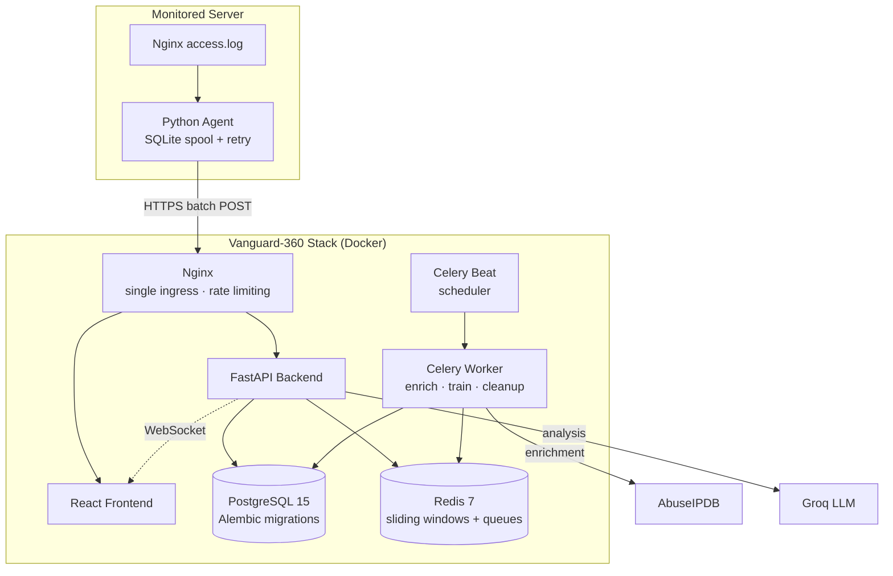

<div align="center">

# 🛡️ Vanguard-360

### Real-time cyber attack monitoring and threat intelligence platform: hybrid rule + ML detection, live world map, and remote collector fleet management for self-hosted infrastructure.

[](https://vanguard.cuetinsights.dev)
[](https://aws.amazon.com/ec2/)
[](./LICENSE)
[](backend/requirements.txt)
[](https://fastapi.tiangolo.com)
[](https://react.dev)
[](https://www.typescriptlang.org)
[](https://vitejs.dev)
[](https://www.postgresql.org)
[](https://redis.io)
[](./docker-compose.yml)

<br />

Vanguard-360 is a self-hosted security operations dashboard. Agents on your servers ship access-log events to the backend, where a hybrid rule and behavioral-ML engine flags suspicious traffic. Alerts are deduplicated, and ingestion handles retries and out-of-order delivery.

Live now at **[vanguard.cuetinsights.dev](https://vanguard.cuetinsights.dev)**, running on an **AWS EC2** instance.

[🐛 Report Bug](https://github.com/sakawatkabir13/Real-time-cyber-attack-monitoring-and-threat-intelligence-platform/issues) · [✨ Request Feature](https://github.com/sakawatkabir13/Real-time-cyber-attack-monitoring-and-threat-intelligence-platform/issues)

</div>

---

## Why Vanguard-360?

Teams that run their own infrastructure often can't see who is hitting their services, what payloads they send, or whether an attack is building. Vanguard-360 fills that gap. A lightweight agent tails your access logs, the backend classifies every event with deterministic signatures and per-source behavioral models, and the dashboard streams detections onto a live world map in real time.

> ⚠️ **Defensive use only.** Vanguard-360 is built to monitor systems **you own or have explicit permission to monitor**. Do not point it at third-party infrastructure. The bundled agent is a detection tool, not an offensive one.

---

## Table of Contents

1. [Video Demo](#video-demo)
2. [Features](#features)
3. [Architecture](#architecture)
4. [API Reference](#api-reference)
5. [Tech Stack](#tech-stack)
6. [Quick Start](#quick-start)
7. [Available Scripts](#available-scripts)
8. [Project Structure](#project-structure)
9. [Environment Variables](#environment-variables)
10. [Docker Deployment](#docker-deployment)
11. [Remote Agent](#remote-agent)
12. [Defensive-Use Disclaimer](#defensive-use-disclaimer)
13. [License](#license)
14. [Acknowledgements](#acknowledgements)

---

## Video Demo

[](https://youtu.be/xVjX5RmXgm4)

A walkthrough of Vanguard-360 monitoring my Spandan website through its Nginx access logs. It starts with live HTTP tests against my own site, then moves to generated events for SQL injection, XSS, path traversal, brute force and HTTP floods, which are sent straight to the ingestion pipeline. The last two ML demos use ordinary-looking successful requests whose combined rate, source diversity and timing differ from the learned baseline, so you can see how behavioral detection works beyond individual request signatures.

[Watch on YouTube](https://youtu.be/xVjX5RmXgm4)

| Time | Segment |
| --- | --- |
| [00:00](https://youtu.be/xVjX5RmXgm4?t=0) | Dashboard overview |
| [00:11](https://youtu.be/xVjX5RmXgm4?t=11) | Normal HTTP traffic |
| [00:35](https://youtu.be/xVjX5RmXgm4?t=35) | Sensitive-file and path traversal probes |
| [01:33](https://youtu.be/xVjX5RmXgm4?t=93) | Login testing with ffuf |
| [02:32](https://youtu.be/xVjX5RmXgm4?t=152) | Simulated SQL injection, XSS, traversal and brute force |
| [03:12](https://youtu.be/xVjX5RmXgm4?t=192) | Single-source HTTP-flood simulation |
| [03:37](https://youtu.be/xVjX5RmXgm4?t=217) | Server-level ML anomaly demonstration |
| [04:46](https://youtu.be/xVjX5RmXgm4?t=286) | Synchronized multi-source ML burst |

All live testing in the video ran against my own deployment. Vanguard monitors and flags traffic but does not block requests. ML scores show unusual behavior relative to a learned baseline, not confirmed attacks or detection accuracy. Map locations are approximate, and the arcs show observed requests, not physical network routes.

---

## Features

Vanguard-360 collects structured access-log events from one or more authorized servers through a lightweight collector. Explainable HTTP rules check each event for known signatures, and behavioral anomaly models score completed server and source traffic windows for unusual patterns once the models are ready. Ingestion uses authenticated batches with stable event identifiers, so delivery is retry-safe and out-of-order events are handled.

The dashboard animates geolocatable observed requests on a live map, with neutral routes for ordinary traffic and severity colors for detections. Persistent source markers and counts stay detection-only. Playback is bounded, with an explicit notice if an overloaded animation backlog is shortened; stored detections are unaffected. Repeated findings are deduplicated into alerts. You can acknowledge them, record investigation outcomes, and review related activity. You can also search IP history, enrich findings with optional reputation and geolocation services, analyze historical log files, and read plain-language AI summaries.

For operations, you can monitor collector heartbeats and pipeline health, pause or resume authorized collectors, and apply retention cleanup. The stack is built for self-hosting. Signed session cookies protect the dashboard when authentication is enabled, sensitive endpoints are rate-limited, production secrets are validated, and everything sits behind a single Nginx ingress. Events and reviews persist in PostgreSQL, Redis holds windows and queues, and Celery runs scheduled work. The repository includes backend tests, frontend tests, linting, dependency checks, and Docker-ready local builds.

Detection results are investigative signals, not automatic proof of malicious intent. Source locations and map routes are approximate representations of observed HTTP data.

---

## Architecture



### Key flows

- Single ingress: The bundled Nginx container is the only externally exposed service. The frontend and backend never accept direct traffic, so the stack needs only one port, which you can put behind your own domain and TLS proxy.
- Idempotent ingestion: Collector events carry stable `event_id` values. Detection storage enforces uniqueness and recent delivery retries are deduplicated. Late contextual rules revisit the latest affected five-minute interval while its Redis counters are retained; this is bounded correction, not unlimited historical reprocessing.
- Detection pipeline: Each event updates contextual counters and passes through signature rules. Behavioral models score completed server/source windows independently once compatible models are available.
- Alert deduplication: High and critical severity events are coalesced into a single alert record with an occurrence counter instead of creating duplicates.
- Collector fleet: Each agent heartbeats in, reports its desired-state, and can be paused or resumed remotely. Offline state is derived from a stale-heartbeat threshold.

---

## API Reference

HTTP endpoints are served under `/api`; the WebSocket stream uses `/ws`. Both sit behind the bundled Nginx. Session requirements below apply when `AUTH_DISABLED=false`.

| Method | Endpoint | Auth | Description |
| --- | --- | --- | --- |
| `POST` | `/api/auth/login` | None | Authenticate and receive a session cookie |
| `POST` | `/api/auth/logout` | None | Clear the current session cookie |
| `GET` | `/api/auth/status` | None | Check current auth state |
| `GET` | `/api/health` | None | Liveness + Redis/PostgreSQL connectivity check |
| `WS` | `/ws` | Session | Real-time threat and alert event stream |
| `POST` | `/api/ingest/batch` | Collector token | Agent log ingestion endpoint |
| `POST` | `/api/collector/heartbeat` | Collector token | Agent heartbeat + desired-state check-in |
| `GET` | `/api/collectors` | Session | List all known collector agents and their status |
| `POST` | `/api/collectors/{server_id}/command` | Session | Pause or resume a collector remotely |
| `GET` | `/api/events` | Session | Recent threat events |
| `GET` | `/api/traffic` | Session | Bounded recent HTTP map telemetry; normal requests are not threat records |
| `GET` | `/api/stats` | Session | Aggregate dashboard statistics (cached) |
| `GET` | `/api/map-config` | Session | Monitored-server coordinates used as the map destination |
| `GET` | `/api/alerts` | Session | List deduplicated alerts, filterable by status |
| `PATCH` | `/api/alerts/{alert_id}/acknowledge` | Session | Acknowledge an alert |
| `PATCH` | `/api/alerts/{alert_id}/resolve` | Session | Resolve an alert |
| `PATCH` | `/api/alerts/{alert_id}/review` | Session | Save an investigation verdict and evidence with revision checking |
| `GET` | `/api/alerts/{alert_id}/reviews` | Session | Read investigation history |
| `GET` | `/api/incidents` | Session | Read suggested related-incident groups |
| `GET` | `/api/ip-lookup/{ip}` | Session | Reputation and history for an IP |
| `POST` | `/api/analyze-threat` | Session | LLM-generated plain-language threat summary |
| `POST` | `/api/analyze-log-file` | Session | Upload and analyze a historical log file |
| `GET` | `/api/analysis-status` | Session | Progress of an in-flight log file analysis |
| `GET` | `/api/ml/status` | Session | Current model training/validation status |

---

## Tech Stack

### Backend
| Layer | Technology |
| --- | --- |
| Runtime | Python 3.11 |
| Framework | FastAPI (async) |
| ORM | SQLAlchemy (async) with `asyncpg` |
| Validation | Pydantic v2 |
| Migrations | Alembic |
| Auth | Session cookies, HMAC-signed, constant-time compared |
| Machine Learning | scikit-learn (`IsolationForest`), `joblib` |
| Background tasks | Celery worker + beat |
| Tests | Pytest + `pytest-asyncio` |

### Frontend
| Layer | Technology |
| --- | --- |
| Framework | React 18 |
| Language | TypeScript 5 |
| Build tool | Vite 7 |
| Styling | Tailwind CSS |
| State | Zustand |
| Data fetching | TanStack Query |
| Real-time | WebSocket threat and alert stream |
| Tests | Vitest + Testing Library + jsdom |

### Database, Infrastructure & Tooling
| Layer | Technology |
| --- | --- |
| Database | PostgreSQL 15 |
| Cache / Queue | Redis 7 |
| Reverse proxy | Nginx (bundled) |
| Orchestration | Docker Compose |
| Lint | ESLint (frontend) |

---

## Quick Start

### Prerequisites

- Docker and Docker Compose v2.x or newer

### 1. Clone the repository

```bash
git clone https://github.com/sakawatkabir13/Real-time-cyber-attack-monitoring-and-threat-intelligence-platform.git
cd Real-time-cyber-attack-monitoring-and-threat-intelligence-platform
```

### 2. Configure environment

```bash
cp .env.example .env
```

> Generate strong secrets for every required field before bringing the stack up. `POSTGRES_PASSWORD` must match the password in `DATABASE_URL`:
>
> ```bash
> openssl rand -hex 32
> ```

For a local run over plain HTTP, also set `ENVIRONMENT=development`, `COOKIE_SECURE=false`, and `HTTP_PORT=8080` in `.env`. The default `HTTP_PORT` is `80`.

### 3. Launch the stack

```bash
docker compose up --build -d
```

On first boot the backend will:

1. Wait for PostgreSQL to be healthy.
2. Run `alembic upgrade head` (idempotent migrations).
3. Start the FastAPI API, the Celery worker, and the Celery beat scheduler.
4. Serve the React frontend through the bundled Nginx ingress.

### 4. Open the apps

| App | URL |
| --- | --- |
| Dashboard (local) | http://localhost:8080 |
| Health check (local) | http://localhost:8080/api/health |
| Live (AWS EC2) | https://vanguard.cuetinsights.dev |

To start monitoring a server, install the agent found in [`agent/`](agent/) on the machine you want to watch and point it at your own Vanguard instance.

---

## Available Scripts

### Root (Docker Compose shortcuts)

| Command | Description |
| --- | --- |
| `docker compose up --build -d` | Build and start the entire stack in the background |
| `docker compose down` | Stop and remove containers |
| `docker compose restart` | Restart all services |
| `docker compose logs -f` | Follow logs from all services |
| `docker compose exec backend alembic upgrade head` | Apply migrations manually |

### Backend (inside `backend/`)

Production images intentionally omit test dependencies. For local development, create a separate environment first:

```bash
python3.11 -m venv .venv
. .venv/bin/activate
python -m pip install -r requirements-dev.txt
```

```bash
pytest -v                 # run tests
alembic upgrade head      # apply migrations
uvicorn app.main:app --reload
```

PostgreSQL integration tests require `VANGUARD_TEST_DATABASE_URL` pointing to a migrated disposable database named `vanguard_test*`. Never point tests at production. CI supplies its own temporary PostgreSQL service; local runs without that variable skip integration tests.

### Frontend (inside `frontend/`)

| Script | Description |
| --- | --- |
| `npm run dev` | Start the Vite dev server with HMR |
| `npm run build` | Production build to `dist/` |
| `npm run preview` | Preview the production build locally |
| `npm run lint` | Run ESLint over the project |
| `npm run test` | Run the Vitest suite once |
| `npm run test:watch` | Run Vitest in watch mode |

### Agent (inside `agent/`)

| Script | Description |
| --- | --- |
| `python agent.py` | Start the agent with values from its `.env` file |
| `python -m pytest test_agent.py` | Agent tests: spool and cursor persistence across restarts, persisted pause command |

---

## Project Structure

```
vanguard-360/
├── backend/                 # FastAPI service
│   ├── app/
│   │   ├── routers/         # ingest, alerts, collectors, incidents
│   │   ├── services/        # detection engine, ML, alerting, geo lookup
│   │   ├── tasks/           # Celery: enrichment, training, cleanup
│   │   ├── schemas/         # Pydantic schemas
│   │   └── models/          # SQLAlchemy models
│   ├── alembic/             # migrations
│   ├── tests/               # Pytest suite
│   ├── generate_demo_events.py   # controlled HTTP detection demos
│   ├── generate_ddos_log.py      # repeatable demo log
│   ├── evaluate_independent.py   # evaluation against reviewed windows
│   ├── Dockerfile
│   └── requirements.txt
├── frontend/                # Vite + React + TS dashboard
│   ├── src/
│   │   ├── components/      # dashboard widgets, charts, layouts
│   │   ├── hooks/           # data hooks (live feed, etc.)
│   │   ├── pages/           # dashboard, map, alerts, ip-lookup, log analyzer, settings
│   │   ├── store/           # global client state
│   │   └── test/            # Vitest tests
│   ├── Dockerfile
│   └── package.json
├── agent/                   # remote log-shipping agent
│   ├── agent.py
│   ├── install.sh
│   ├── vanguard-agent.service
│   ├── test_agent.py
│   ├── .env.example
│   └── requirements.txt
├── nginx/                   # bundled ingress configuration
├── ops/                     # external production health monitor
│   ├── monitor.py
│   └── test_monitor.py
├── .github/
│   └── workflows/
│       ├── ci.yml           # GitHub Actions CI
│       └── monitor.yml      # scheduled health check
├── docker-compose.yml
├── .env.example
├── LICENSE
└── README.md
```

---

## Environment Variables

All variables are loaded from `.env` via `pydantic-settings`. Server-side secrets must never be committed.

| Variable | Required | Description |
| --- | :---: | --- |
| `ENVIRONMENT` | Yes | `development` \| `production`. Production refuses placeholder secrets |
| `AUTH_DISABLED` | No | Default `false`; set `true` only if you intentionally want dashboard access to be public |
| `POSTGRES_PASSWORD` | Yes | PostgreSQL password; must match the password encoded in `DATABASE_URL` |
| `DATABASE_URL` | Yes | Async PostgreSQL connection string |
| `DATABASE_SSL` | No | `true` when connecting through TLS |
| `REDIS_URL` | Yes | Redis connection string |
| `COLLECTOR_TOKEN` | Yes | Shared secret agents use to authenticate ingestion |
| `SECRET_KEY` | Yes | HMAC key for dashboard session tokens |
| `DASHBOARD_PASSWORD` | Yes | Dashboard login credential |
| `SESSION_TTL_SECONDS` | No | Default `43200` (12h) |
| `CORS_ORIGINS` | No | Leave empty (same-origin behind bundled Nginx) |
| `COOKIE_SECURE` | No | Must be `true` in production |
| `ABUSEIPDB_API_KEY` | No | Enables IP reputation enrichment |
| `GROQ_API_KEY` | No | Enables LLM-powered threat summaries |
| `GROQ_MODEL` | No | Groq model ID; default `openai/gpt-oss-120b` |
| `ANALYSIS_UPLOAD_DIR` | No | Shared durable storage for queued manual log jobs |
| `MAXMIND_DB_PATH` | No | Optional MaxMind GeoLite2-City.mmdb path |
| `EVENT_RETENTION_DAYS` | No | Default `30` |
| `ALERT_DEDUPE_SECONDS` | No | Default `900` |
| `COLLECTOR_OFFLINE_SECONDS` | No | Default `45` |
| `ML_MIN_TRAINING_WINDOWS` | No | Minimum behavioral windows before training runs |
| `ML_CONTAMINATION` | No | Default `0.02` |
| `ML_ALERT_SCORE` | No | Score threshold for ML alerts (default `90.0`) |
| `TARGET_LATITUDE` / `TARGET_LONGITUDE` | No | Your server coordinates, used for map arc destinations |

Full reference with defaults lives in [`.env.example`](./.env.example).

### Configuration highlights

These variables need more explanation than a table row allows:

- `CORS_ORIGINS`: leave this empty. The frontend and API are same-origin behind the bundled Nginx, so production needs no cross-origin configuration. Adding origins widens your attack surface.
- `AUTH_DISABLED`: makes the dashboard public, including collector controls, alert modifications and log uploads. This is not a read-only role. It bypasses dashboard session and WebSocket authentication, but collector bearer-token authentication stays enabled. Keep it `false` except for an intentionally unrestricted demonstration.
- `COOKIE_SECURE`: must be `true` in production. The backend refuses to start otherwise (see `validate_production_secrets` in `backend/app/config.py`).
- `ML_MIN_TRAINING_WINDOWS`: controls when the behavioral IsolationForest models start scoring. Too low and you train on noise; too high and you get no ML coverage early in a deployment.
- `ML_ALERT_SCORE`: the anomaly-score threshold (0 to 100) above which a flagged event becomes a persisted ML alert. Tune it together with `ML_CONTAMINATION`.
- `TARGET_LATITUDE` / `TARGET_LONGITUDE`: the destination coordinate for the live map's arcs. Set them to the monitored server's approximate hosting location. Arcs show geographic endpoints, not the actual network route of the packets.
- `ABUSEIPDB_API_KEY`: without it, IP reputation enrichment falls back to "no data". The dashboard still works, but the IP lookup panel shows blanks.
- `GROQ_API_KEY`: without it, the threat summary endpoint returns an "AI disabled" message instead of a plain-language analysis.
- `GROQ_MODEL`: selects the Groq-hosted model used for summaries. The default is `openai/gpt-oss-120b`.

Manual log uploads are copied to private shared storage and processed by Celery
with late acknowledgement. Progress lives in Redis. Transient dependency errors
retry up to five times with backoff; the input is retained for retries and removed
after completion or terminal failure, with a two-day orphan retention limit.
Stable per-line event IDs make worker redelivery safe.

The scheduled GitHub health monitor requires the repository variable
`VANGUARD_MONITOR_ENABLED=true` and the `MONITOR_SMTP_APP_PASSWORD` secret for
Gmail delivery. An SMTP secret alone does not enable scheduled checks. Failed
notifications retry on subsequent checks without repeating an already delivered
outage email. No automatic deployment workflow is enabled.

### Detection Pipeline

Every ingested event is evaluated in order:

1. Context counters: event-time request volume, path repetition, failures and measured slow responses per server/source
2. Signature rules: SQL injection, XSS, path traversal, brute force, scanner/recon patterns
3. Behavioral aggregation: summarizes real server/source traffic windows. An independent scheduled worker scores completed windows, even if a source stops sending requests. Compatible IsolationForest models start scoring only after enough eligible data accumulates (`ML_MIN_TRAINING_WINDOWS`).

Detected suspicious events are persisted, not every normal request. Traffic summaries retain normal activity for training. A finding is not proof of an attack: human investigation records the outcome. High/critical events and ML findings create deduplicated alerts.

The map receives valid ingested HTTP requests through a separate WebSocket feed. Normal requests produce transient neutral arcs, not persistent source dots, detection counts, or alerts. Redis retains up to `MAP_TRAFFIC_LIMIT` recent requests (default 5,000, at most seven days) for reconnect recovery; it is not a complete access-log archive. Requests without reliable source or destination coordinates cannot be drawn. Up to 96 routes animate at once with at most 1,000 waiting; sustained overload omits the oldest pending animations with a visible count, not stored detections. Query strings and request bodies are not included in normal map telemetry.

Known scanner indicators, including ffuf's `Fuzz Faster U Fool` user-agent, exclude both source and server windows from baseline training regardless of their ML score. Rate-limited login requests also exclude their windows; repeated authentication rejections can trigger a possible brute-force finding. HTTP 429 means throttling, not proof that a password was invalid or an account was compromised.

Accuracy metrics still require a real labeled holdout.

Model fitting, score calibration and promotion validation use separate chronological
periods, with equal-timestamp source windows kept together. Validation observations
are not removed to make promotion pass. Rejected candidates leave the last good
model in place; component timestamps preserve honest freshness reporting. This
baseline check is not an independent accuracy measurement. Bundled demo event IDs
and `Vanguard-Demo` user-agents exclude their windows from future baseline training
without suppressing their detection or ML scoring. Existing historical data needs
independent provenance review; new safeguards do not relabel old windows automatically.

---

## Docker Deployment

Vanguard-360 ships a multi-service `docker-compose.yml` that boots PostgreSQL, Redis, the FastAPI backend, the Celery worker + beat, the React frontend, and the bundled Nginx ingress together.

```bash
# Build & start everything
docker compose up --build -d

# Follow logs
docker compose logs -f

# Tests use the separate development environment described above.

# Apply migrations or re-train
docker compose exec backend alembic upgrade head
docker compose exec backend python -c 'from app.tasks.train_model import train_model_task; print(train_model_task.delay().id)'

# Tear down (keeps volumes)
docker compose down

# Tear down (removes volumes too)
# WARNING: permanently removes database, Redis and model data. Not an upgrade step.
docker compose down -v
```

A healthchecked PostgreSQL ensures Alembic migrations only run after the DB is ready.

---

## Remote Agent

The agent in [`agent/`](agent/) is a small Python process that tails a local Nginx (or any line-oriented) access log and ships parsed events to your Vanguard instance over HTTPS.

### Highlights
- A SQLite-backed spool queue survives crashes, network outages, and restarts.
- Delivery is at-least-once, and every event carries a stable `event_id` so the backend can deduplicate.
- Authentication uses the shared `COLLECTOR_TOKEN`.
- Heartbeats include a desired state, so the dashboard can pause and resume the agent remotely.
- A systemd unit, `vanguard-agent.service`, is included for production hosts.

### Install on a monitored server

```bash
git clone https://github.com/sakawatkabir13/Real-time-cyber-attack-monitoring-and-threat-intelligence-platform.git
cd Real-time-cyber-attack-monitoring-and-threat-intelligence-platform/agent
sudo ./install.sh
```

The installer copies the agent to `/opt/vanguard-agent`. On the first run it creates `/opt/vanguard-agent/.env` from `agent/.env.example` and stops so you can edit it. Set `BACKEND_URL` to your Vanguard URL, `COLLECTOR_TOKEN` to the token from your Vanguard `.env`, and `SERVER_ID` and `LOG_PATH` for the monitored server. Then run `sudo ./install.sh` again to install the dependencies and start the systemd service.

---

## Defensive-Use Disclaimer

1. **Monitor only what you own.** Vanguard-360 is designed for defensive monitoring of infrastructure you operate or have explicit written permission to monitor.
2. No offensive features. The agent parses access logs and ships parsed events. It does not scan, exploit, or probe third-party systems.
3. Local laws apply. Operators are responsible for ensuring their configuration and use complies with applicable laws and the policies of any upstream provider.

---

## License

This project is licensed under the MIT License. See the [`LICENSE`](./LICENSE) file for details.

© 2026 Mohammad Sakawat Kabir

---

## Acknowledgements

- [AbuseIPDB](https://www.abuseipdb.com/) for IP reputation data
- [Groq](https://groq.com/) for LLM inference in threat analysis
- [FastAPI](https://fastapi.tiangolo.com/) and [SQLAlchemy](https://www.sqlalchemy.org/) for the async backend
- [TanStack](https://tanstack.com/), [Tailwind CSS](https://tailwindcss.com/), and the [Vite](https://vitejs.dev/) team for the frontend tooling
- [PostgreSQL](https://www.postgresql.org/) and [Redis](https://redis.io/) for storage, windows, and queues
- [scikit-learn](https://scikit-learn.org/) for the `IsolationForest` behavioral scoring layer
- Every operator running their own stack. This project exists to make that easier.

---

<div align="center">

If you find this project useful, consider giving it a star.

Made by [@sakawatkabir13](https://github.com/sakawatkabir13)

</div>
